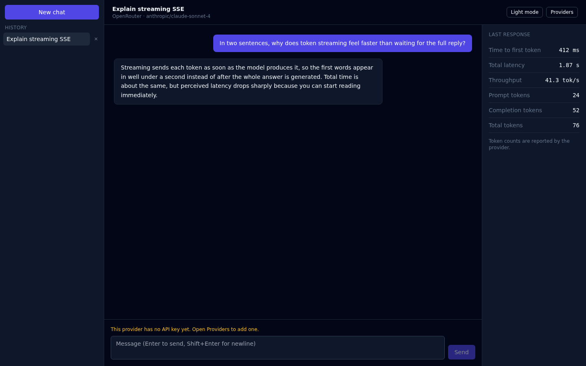
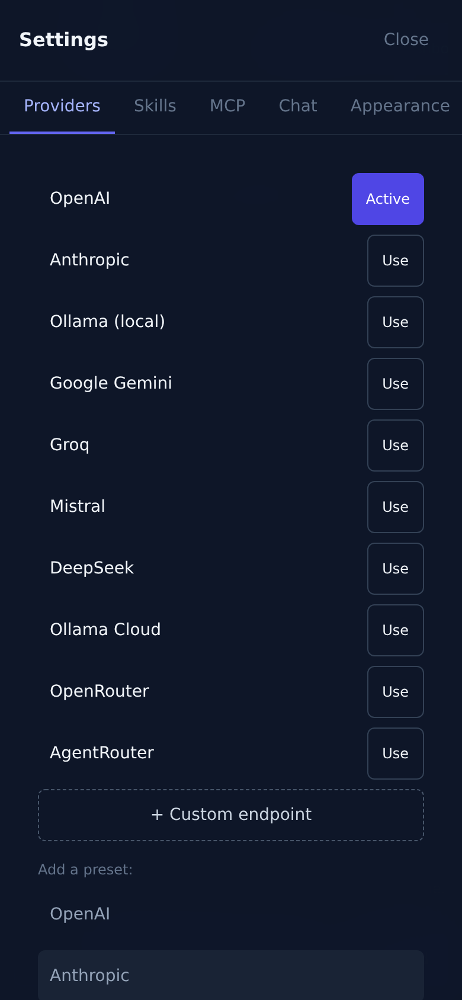
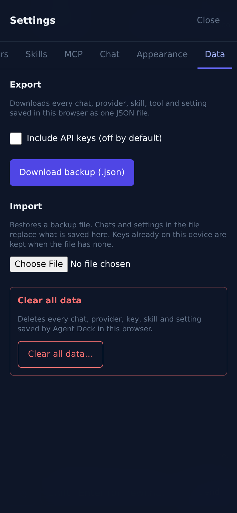

# MercuReal Assistant

A multi-LLM playground. Chat with OpenAI-compatible endpoints (OpenAI, Ollama, LM Studio, OpenRouter, any custom base URL) and Anthropic, with token-by-token streaming and per-response stats.



*Chat view with per-response stats. The conversation shown is seeded sample data, not a live provider response.*

## Features

- Streaming chat UI: responses render token by token, with a stop button.
- Provider switcher: OpenAI-compatible base URL, Anthropic, or any custom endpoint, with presets.
- API keys live only in your browser's `localStorage`. They are sent only to the base URL of the provider they belong to. There is no backend.
- Conversation history sidebar, stored locally.
- Per-response stats: time to first token, total latency, tokens per second, and prompt/completion token counts. Token counts are estimated when the provider does not report usage.
- Dark mode (default) and light mode.

## Requirements

- Node.js 20 or newer
- npm 10 or newer

## Setup

```bash
git clone https://github.com/<your-username>/agent-deck.git
cd agent-deck
npm install
npm run dev
```

Open the printed local URL, click **Providers**, pick a preset, paste your API key, and click **Use**.

## Deploy to Vercel

Agent Deck is a static Vite app, so it deploys to Vercel with no backend. `vercel.json` already sets the framework, build command (`npm run build`), and output directory (`dist`).

1. Go to [vercel.com](https://vercel.com) and sign in with GitHub.
2. Click **Add New... > Project**, then import the `agent-deck` repository.
3. Keep the detected settings and click **Deploy**.

API keys are entered in the browser after the site loads and stay in that browser's `localStorage`, so no environment variables are needed.

## Scripts

| Command           | What it does                              |
| ----------------- | ----------------------------------------- |
| `npm run dev`     | Start the Vite dev server                 |
| `npm run build`   | Type-check, then produce a production build in `dist/` |
| `npm run preview` | Serve the production build locally        |
| `npm run lint`    | Run ESLint with zero warnings allowed     |
| `npm test`        | Run the Vitest suite once                 |
| `npm run test:watch` | Run Vitest in watch mode               |

## CORS

Browsers block cross-origin requests unless the provider allows them. OpenAI and OpenRouter allow browser requests. Anthropic requires the `anthropic-dangerous-direct-browser-access` header, which Agent Deck sends. Local servers such as Ollama may need `OLLAMA_ORIGINS` set to include the dev server origin (for example `http://localhost:5173`).

## Security notes

- Keys are stored unencrypted in `localStorage` on the device you use. Anyone with access to that browser profile can read them. Use keys with spending limits.
- Do not commit `.env` files or keys. `.gitignore` excludes `.env*` (except `.env.example`).
- The app never sends your keys or messages anywhere except the endpoint you configured.

## Settings

Open Settings from the button at the bottom of the left sidebar (on phones, open the sidebar with the menu button first). On phones it opens as a full-screen sheet; on desktop it is a centered panel.

Tabs:
- Providers: API keys, base URLs, model fetch, and presets.
- Skills: enable or disable the bundled skills.
- MCP: browse the bundled web-dev MCP catalog and manage remote connections.
- Chat: fallback chain, system prompt default, temperature and max tokens.
- Appearance: light or dark theme and font size.
- Data: export every chat and setting as JSON, import a backup, or clear all data. API keys are left out of exports unless you tick the box.





## Skills

agent-deck ships 50 curated web-development skills in `src/skills/`. A skill is a short prompt of rules for one topic. Invoke it in chat to steer the model for that conversation.

### How to call a skill

Type `@` followed by the skill slug anywhere in your message. A dropdown appears as you type; use the arrow keys and Enter (or Tab, or tap) to pick one. Exact syntax:

- `@slug` must start the message or follow a space. Example: `@react-hooks review this component`
- Slugs are lowercase letters, digits, and hyphens, as listed in the table below.
- Stack several skills in one message: `@sec-xss @a11y-forms-feedback review this login form`
- Unknown slugs and email addresses like `me@react-hooks.com` are ignored.
- Skills apply to the message they appear in. Their rules are added to the system message for that request (appended to an existing system message, or a new one is created). Earlier messages are not re-scanned, so invoke a skill again in a new message to keep it active.
- Turn a skill off in Settings, Agent skills, and its `@slug` is ignored everywhere. The on/off toggle is stored on this device.

### Examples

- `@react-server-components should this page be a server component? here is the file: ...`
- `@perf-core-web-vitals @perf-images-fonts my hero image is making LCP slow`
- `@test-react-testing-library write tests for the cart drawer`
- `@devops-ci-github-actions @sec-dependency-audit set up CI for this repo`

### Bundled skills

Slugs are the names you type after `@`. Category is shown in the table.

| Invoke | Name | Category | Description |
| --- | --- | --- | --- |
| `@react-hooks` | React hooks | react | Hook rules, dependency arrays, custom hooks, and avoiding effects for derived state. |
| `@react-server-components` | React server and client components | react | Server vs client component boundaries, serialization limits, and data fetching placement. |
| `@react-state` | React state placement | react | Choosing local, lifted, context, server-cache, or URL state without redundant copies. |
| `@react-composition` | React composition patterns | react | Composition over prop drilling and boolean-prop explosion; compound components. |
| `@react-forms` | React forms | react | Controlled and uncontrolled inputs, validation timing, accessible errors, and submit states. |
| `@react-error-boundaries` | React error boundaries and Suspense | react | Error boundaries, Suspense fallbacks, and graceful degradation for failed sections. |
| `@ts-strict-types` | Strict TypeScript types | typescript | Strict typing: avoid any, narrow with guards, use unknown at boundaries, discriminated unions. |
| `@ts-generics` | TypeScript generics and utility types | typescript | Generics with constraints, inference-friendly signatures, and restrained mapped or conditional types. |
| `@ts-api-types` | TypeScript types for API data | typescript | Validate external data at runtime and derive types from the validator, not from casts. |
| `@ts-config` | TypeScript configuration | typescript | tsconfig strictness, module resolution for Vite and Node, and path aliases. |
| `@ts-errors` | TypeScript error handling | typescript | Typed error handling with result values and narrowing on error types. |
| `@tailwind-utilities` | Tailwind utility conventions | css | Utility-first Tailwind usage, spacing scale discipline, and avoiding @apply sprawl. |
| `@tailwind-responsive` | Mobile-first responsive layout | css | Mobile-first breakpoints, container queries, and fluid sizing with clamp(). |
| `@css-layout` | CSS layout with flexbox and grid | css | Choosing flex vs grid, intrinsic sizing, and the min-width:0 and overflow pitfalls. |
| `@css-theming` | CSS theming and design tokens | css | Design tokens as CSS custom properties, light and dark themes, and color-scheme. |
| `@css-animation` | CSS animation with reduced motion | css | Motion that animates transform and opacity and respects prefers-reduced-motion. |
| `@perf-core-web-vitals` | Core Web Vitals optimization | performance | Improve LCP, INP, and CLS by fixing measured causes, not guessing. |
| `@perf-bundle-size` | JavaScript bundle size | performance | Code splitting, lazy routes, tree shaking, and checking what actually ships. |
| `@perf-rendering` | React rendering performance | performance | Avoid needless re-renders, memoize only when measured, and virtualize long lists. |
| `@perf-images-fonts` | Images and web font loading | performance | Image dimensions and formats, lazy loading, and font-display and preload strategy. |
| `@perf-network-caching` | Network caching and request waterfalls | performance | Cache headers, request waterfalls, prefetching, and deduplicating requests. |
| `@a11y-semantic-html` | Semantic HTML first | accessibility | Use native elements before ARIA, with landmarks, heading order, and correct lists. |
| `@a11y-keyboard-focus` | Keyboard access and focus management | accessibility | Keyboard operability, visible focus, focus trapping in dialogs, and skip links. |
| `@a11y-aria` | ARIA roles, names, and states | accessibility | Correct ARIA roles, accessible names, and state attributes; the first rule of ARIA. |
| `@a11y-color-contrast` | Color contrast and visual access | accessibility | WCAG AA contrast, not relying on color alone, and text that scales. |
| `@a11y-forms-feedback` | Accessible forms and status messages | accessibility | Labels, error association, and live regions for status and async feedback. |
| `@test-unit-vitest` | Unit testing with Vitest | testing | Arrange-act-assert unit tests, boundary mocking, and testing behavior not internals. |
| `@test-react-testing-library` | React Testing Library | testing | Query by role and label, simulate real user events, and wait for async UI correctly. |
| `@test-e2e-playwright` | End-to-end testing with Playwright | testing | Stable locators, web-first assertions, fixtures, and CI-friendly retries. |
| `@test-msw-mocking` | API mocking with MSW | testing | Mock Service Worker for network-level mocks shared by tests and local dev. |
| `@test-tdd` | Test-driven development | testing | Red, green, refactor: write the failing test first and keep each step minimal. |
| `@sec-xss` | Preventing XSS | security | Escape output, avoid raw HTML injection, sanitize user HTML, and set a strict CSP. |
| `@sec-auth-sessions` | Authentication and sessions | security | Secure session cookies, token storage tradeoffs, and CSRF protection. |
| `@sec-secrets` | Secrets and environment variables | security | Keep secrets server-side, handle env vars safely, and rotate anything leaked. |
| `@sec-input-validation` | Input validation and injection | security | Validate all external input on the server with allowlists and parameterized queries. |
| `@sec-dependency-audit` | Dependency and supply-chain security | security | Audit dependencies, commit lockfiles, and keep the dependency surface small. |
| `@api-rest-design` | REST API design | node | Resource naming, status codes, pagination, filtering, and idempotent writes. |
| `@api-error-handling` | API error responses | node | A consistent error envelope with stable codes and no internal details leaked. |
| `@node-async` | Async correctness in Node | node | Promise combinators, cancellation with AbortSignal, timeouts, and avoiding unhandled rejections. |
| `@node-express-fastify` | Node HTTP server structure | node | Middleware ordering, request validation, and graceful shutdown for Express or Fastify. |
| `@api-graphql` | GraphQL API design | node | Schema design, avoiding N+1 queries with batching, and limiting query cost. |
| `@devops-ci-github-actions` | CI with GitHub Actions | devops | Lint, test, and build gates with caching, matrix runs, and pinned actions. |
| `@devops-docker` | Docker images | devops | Multi-stage builds, small images, non-root users, and health checks. |
| `@devops-deploy-vercel` | Deploying on Vercel | devops | Preview deployments, per-environment variables, cache headers, and rollback. |
| `@devops-observability` | Logging, errors, and health checks | devops | Structured logs, error tracking, metrics, and health endpoints. |
| `@arch-feature-folders` | Feature-based folder structure | architecture | Feature folders, clear module boundaries, and no circular imports. |
| `@arch-api-layer` | Separating the API layer from UI | architecture | Keep the API client and data access out of components. |
| `@arch-state-boundaries` | State boundaries | architecture | Decide which state is server data, which is client UI state, and keep them apart. |
| `@arch-adr` | Architecture decision records | architecture | Record decisions with context, the choice, and consequences so they can be revisited. |
| `@arch-monorepo-boundaries` | Monorepo module boundaries | architecture | Dependency direction rules, shared packages, and enforcing boundaries in tooling. |

### Adding a custom skill

1. Create `src/skills/your-slug.md` with this frontmatter and body:

```
---
name: Human readable name
slug: your-slug
category: react
description: One short line describing when to use it.
---

Apply these rules when relevant:

- Rule one.
- Rule two.
```

2. `slug` must match the file name, use lowercase letters, digits, and hyphens, and be unique. `name`, `category`, and `description` are required. A file missing any of these, or with an invalid slug, is skipped.
3. Rebuild or restart the dev server. The skill appears in the Settings table and in the `@` dropdown.
4. Keep bodies short and actionable (a few bullet points). Long bodies cost context on every message that uses them.

Skills can also be installed directly from a GitHub repository link in Settings, Agent skills. Those are stored in this browser only.

## Project structure

```
src/
  lib/            pure logic: SSE parsing, request building, stats, storage
  components/     Sidebar, ChatView, StatsPanel, SettingsPanel, SkillsPanel
  skills/         bundled web-development skill prompts (markdown) and index
  App.tsx         app state and streaming orchestration
  lib/*.test.ts   vitest tests for the pure modules
```

## Contributing

Run `npm run lint && npm test && npm run build` before opening a pull request. CI runs the same steps on Node 20 and 22.

## License

MIT. See [LICENSE](LICENSE).


## MCP

agent-deck bundles a catalog of 50 web-development MCP (Model Context Protocol) servers. Open the MCP panel in settings to browse them. Each entry has a config snippet you can copy into your own MCP client (Claude Desktop, Cursor, VS Code, and so on).

| # | Name | Category | Transport | Description |
|---|---|---|---|---|
| 1 | Filesystem | reference | stdio | Read, write and search files inside directories you allow. |
| 2 | Fetch | web | stdio | Fetch any URL and convert the page to markdown for the model. |
| 3 | Memory | reference | stdio | Persistent knowledge-graph memory across sessions. |
| 4 | Sequential thinking | reference | stdio | Structured step-by-step reasoning scaffold for hard problems. |
| 5 | Time | utility | stdio | Current time and timezone conversion. |
| 6 | Git | git | stdio | Read, search, diff and commit in a local git repository. |
| 7 | GitHub | git | http | Repos, issues, pull requests, Actions and code search (hosted by GitHub). |
| 8 | GitLab | git | stdio | GitLab projects, merge requests, issues and pipelines. |
| 9 | PostgreSQL | database | stdio | Read-only SQL queries and schema inspection on PostgreSQL. |
| 10 | SQLite | database | stdio | Query and inspect a local SQLite database file. |
| 11 | MySQL | database | stdio | Run queries and inspect tables on a MySQL database. |
| 12 | MongoDB | database | stdio | Query collections and manage indexes on MongoDB. |
| 13 | Neon | database | stdio | Manage Neon Postgres projects, branches and SQL. |
| 14 | Prisma | database | stdio | Prisma schema, migrations and Prisma Postgres management. |
| 15 | Airtable | database | stdio | Read and write Airtable bases, tables and records. |
| 16 | Supabase | backend | http | Supabase projects: tables, SQL, edge functions, logs and advisors (hosted). |
| 17 | Vercel | hosting | http | Vercel projects, deployments, logs and docs search (hosted, OAuth). |
| 18 | Netlify | hosting | stdio | Netlify sites, deploys and functions via the Netlify MCP. |
| 19 | Playwright | browser | stdio | Drive a real browser with accessibility snapshots for end-to-end checks. |
| 20 | Puppeteer | browser | stdio | Chrome automation: navigate, click, fill forms and take screenshots. |
| 21 | Chrome DevTools | browser | stdio | DevTools access: performance traces, network and console for debugging pages. |
| 22 | Figma | design | http | Read Figma files, frames and design tokens into code (hosted, OAuth). |
| 23 | Figma (Framelink) | design | stdio | Community Figma server: layout and styling data from Figma files. |
| 24 | shadcn/ui | ui | stdio | Browse, search and install shadcn/ui components into your project. |
| 25 | ESLint | quality | stdio | Lint files and apply ESLint fixes from the model. |
| 26 | Sentry | monitoring | http | Search errors, analyze issues and read performance data (hosted, OAuth). |
| 27 | Jira | project | stdio | Atlassian Jira issues, boards and sprints. |
| 28 | Notion | docs | stdio | Search and edit Notion pages and databases. |
| 29 | Context7 | docs | stdio | Up-to-date library documentation and code examples pulled into context. |
| 30 | MarkItDown | docs | stdio | Convert PDFs, Office files and HTML into markdown. |
| 31 | AWS documentation | cloud | stdio | Search and read official AWS documentation. |
| 32 | Brave Search | search | stdio | Web and local search through the Brave Search API. |
| 33 | Exa | search | stdio | Semantic web search and page contents via Exa. |
| 34 | Tavily | search | stdio | Search and extract web content for research tasks. |
| 35 | Perplexity | search | stdio | Sourced answers and web search through Perplexity. |
| 36 | Firecrawl | web | stdio | Scrape, crawl and map websites into clean markdown. |
| 37 | Google Maps | search | stdio | Geocoding, places and directions. |
| 38 | OpenAPI | api | stdio | Turn any OpenAPI spec into callable tools for an API. |
| 39 | Postman | api | stdio | Postman collections, environments and API requests. |
| 40 | Stripe | payments | stdio | Stripe customers, payments, products and docs. |
| 41 | Resend | email | stdio | Send transactional email and manage domains with Resend. |
| 42 | Slack | comms | stdio | Read channels and post messages in Slack. |
| 43 | Semgrep | security | stdio | Static analysis and security scans with Semgrep rules. |
| 44 | Snyk | security | stdio | Dependency and code vulnerability scans through Snyk. |
| 45 | Mermaid | diagram | stdio | Render Mermaid diagrams (flowcharts, sequence diagrams) to images. |
| 46 | Chroma | vector | stdio | Store and query embeddings in a Chroma vector database. |
| 47 | Qdrant | vector | stdio | Semantic search and storage on a Qdrant vector database. |
| 48 | E2B sandbox | sandbox | stdio | Run code and dev servers in isolated E2B cloud sandboxes. |
| 49 | MDN Web Docs | docs | stdio | Search and read MDN Web Docs for HTML, CSS and JavaScript references. |
| 50 | Everything (reference test server) | testing | stdio | Reference server that exercises every MCP feature, useful to test a client. |

Browser limitation. agent-deck runs entirely in the browser. Browsers cannot spawn local processes, so stdio servers (the npx and uvx entries above) cannot run inside agent-deck. They are reference only. Only streamable HTTP servers with a remote URL can be connected from the app.

Connecting a remote server. Open settings, then MCP, then Connections. Enter a name, the https URL of the server's MCP endpoint, and an optional auth header as a raw line such as Authorization: Bearer YOUR_KEY. Save, then enable the connection. agent-deck sends initialize and tools/list over JSON-RPC to discover its tools.

Using the tools in chat. Enabled connections with discovered tools are listed to the model in a system note. Type /mcp to list connections and their tools. Type /mcp call TOOL {"arg": "value"} to run one tool directly. Commands run locally and make no model call. @mcp works the same way.

CORS. The remote server must send CORS headers that allow the agent-deck origin. If it does not, the browser blocks the request and agent-deck shows a CORS error. Servers that do not allow browser origins cannot be used from agent-deck.

Keys and privacy. Auth headers are stored in localStorage on this device, unencrypted, like other keys in agent-deck. Use keys with spending limits. Only the configured endpoint receives your request.

## Features (AI studio)

Logic in place and covered by tests (src/lib/*.test.ts):

- PWA: installable manifest, service worker offline app shell (API calls always go to the network)
- Markdown parser (headings, lists, quotes, http links, fenced code that tolerates an unclosed fence while streaming) and a syntax-highlighting tokenizer
- Estimated cost calculator with an editable per-model pricing table (estimates, not billing)
- Fuzzy command palette search and the keyboard shortcut list
- Prompt library helpers: {{variable}} extraction and fill, /prompt command parsing
- Stop-token cleanup for streamed text
- Reply variants (A/B swipe), auto-title from the first exchange
- Message search across conversations, conversation sort (pinned, favorite, recent, title), tags
- Read-only snapshot encode/decode (compressed #snap= hash), export text wrapping
- Voice input and output helpers (Web Speech API, SpeechSynthesis)

Not yet wired into the chat UI: the helpers above are not yet hooked into the visible interface.
